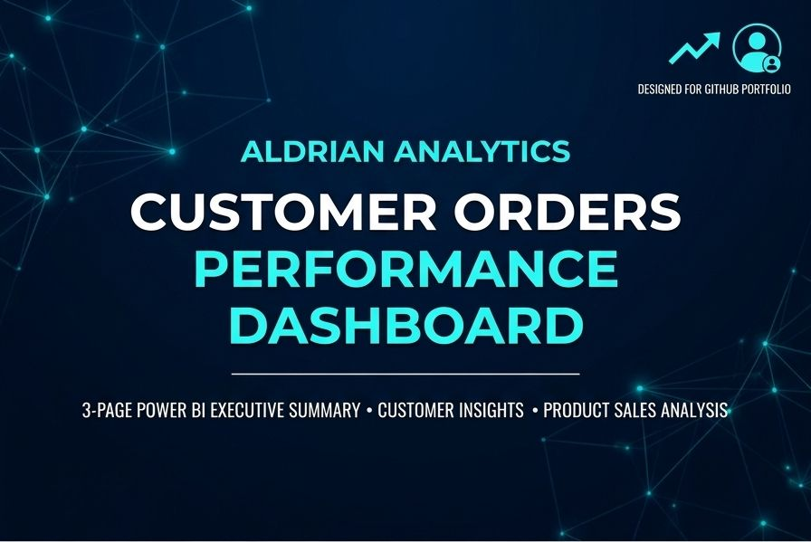
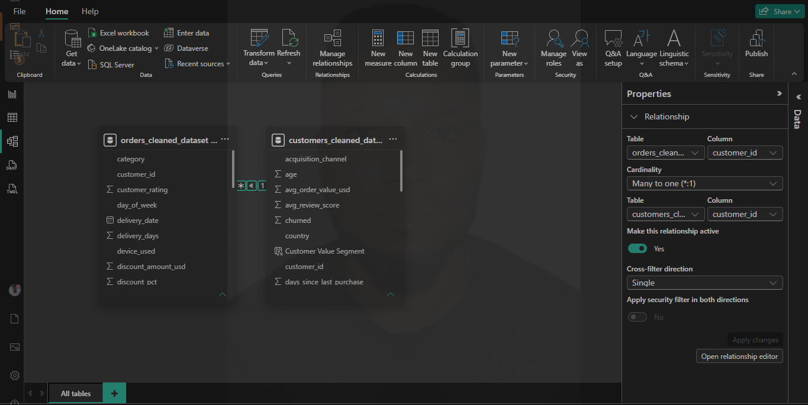
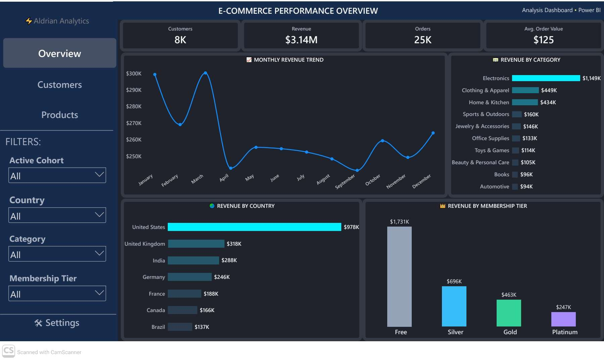
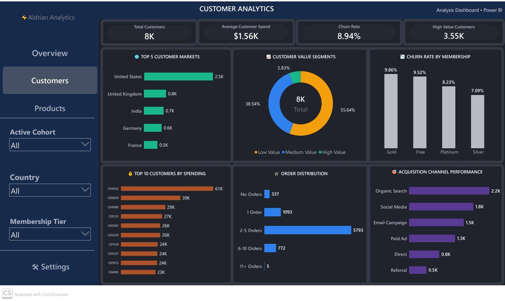
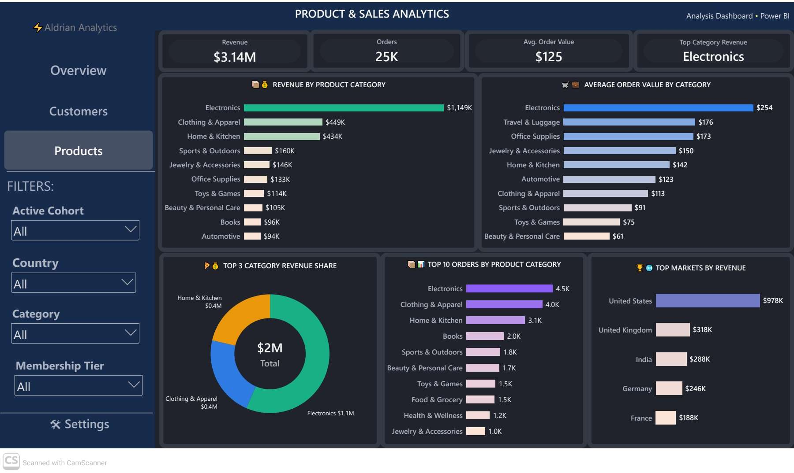

# Customer Orders Analysis

<p align="center">
  
</p>

<p align="center">
  <strong>End-to-End SQL and Power BI Data Analytics Project</strong>
</p>

<p align="center">
  Customer Analytics | Sales Performance | Customer Retention | Business Intelligence
</p>

## Project Overview

Customer Orders Analysis is a data analytics project designed to transform customer and order data into actionable business insights. The project focuses on customer behavior, sales performance, product profitability, membership performance, purchasing patterns, and customer retention.

Using SQL for data analysis and Power BI for visualization, the project explores key business questions and presents findings through interactive dashboards that support data-driven decision-making.

## Project Objectives

- Analyze overall sales and revenue performance.
- Identify top-performing product categories.
- Evaluate customer spending behavior and lifetime value.
- Compare customer distribution across countries.
- Analyze membership tier performance.
- Examine customer order frequency and repeat purchasing behavior.
- Measure customer churn and identify high-value customers.
- Evaluate acquisition channel performance.
- Investigate the relationship between discounts, customer spending, and customer tenure.

## Tools and Technologies

- **SQL:** Data querying, aggregation, joins, common table expressions (CTEs), and customer analytics.
- **Microsoft Power BI:** Interactive dashboards, KPI reporting, and business intelligence visualization.
- **GitHub:** Project documentation, version control, and portfolio presentation.

## Project Structure

```text
customer-orders-analysis/
│
├── README.md
│
├── sql/
│   └── 02_customer_order_analysis.sql
│
├── dashboard/
│    │── customer_orders_dashboard.pbix
│    └── dashboard_preview.pdf
│
│
│── data/
│    │── customers_cleaned_data.csv
│    └── orders_cleaned_data.csv
│
│   
└── images/
        ├── Overview_tab.png
        ├── customer_analytics_tab.jpg
        ├── projwct_banner.jpg
        ├── Data_model.png
        └── product_sales_analytics.jpg
```


## Data Model

The data model illustrates how the project's tables are organized and related. It helps explain the relationships between customers, orders, and any other tables used in the analysis

<p align="center">
  
</p>


## Power BI Report

The Power BI report provides interactive views of e-commerce performance, customer behavior, and product sales.

[Download the Power BI Report (.pbix)](dashboard/customer_orders_dashboard.pbix)

Download the Power BI file from the repository and open it using Microsoft Power BI Desktop.


## PDF Dashboard Report

A PDF version of the dashboard is provided for users who want to review the visualizations without opening Power BI Desktop.

[View or Download the Dashboard PDF](dashboard/customer_preview.pdf)

The PDF contains static dashboard pages and is intended for convenient review and presentation. Use the Power BI report for interactive exploration, where supported.


## Dashboard Previews

### 1. E-Commerce Performance Overview

This dashboard provides a high-level overview of business performance, including revenue, order volume, customer count, average order value, monthly revenue trends, revenue by product category, geographic performance, and membership tier contributions.

**Key Performance Indicators**
- Total Customers: approximately 8,000
- Total Revenue: approximately $3.14 million
- Total Orders: approximately 25,000
- Average Order Value: approximately $125

**Dashboard Screenshot**

<p align="center">
  
</p>


### 2. Customer Analytics Dashboard

This dashboard examines customer behavior, spending patterns, customer value segments, churn, order frequency, geographic distribution, and acquisition channels.

**Key Insights Displayed**
- Total Customers: approximately 8,000
- Average Customer Spend: approximately $1,560
- Customer Churn Rate: approximately 8.94%
- High-Value Customers: approximately 3,550
- Customer distribution by country and membership tier
- Order frequency and repeat purchasing patterns
- Customer acquisition channel performance
- Highest-spending customers

**Dashboard Screenshot**

<p align="center">
  
</p>


### 3. Product and Sales Analytics Dashboard

This dashboard focuses on product category performance, revenue contribution, order volume, average order value, and sales across geographic markets.

**Key Insights Displayed**
- Total Revenue: approximately $3.14 million
- Total Orders: approximately 25,000
- Average Order Value: approximately $125
- Top Revenue-Generating Category: Electronics
- Revenue contribution by product category
- Average order value by category
- Product category order distribution
- Revenue performance across major markets

**Dashboard Screenshot**

<p align="center">
  
</p>


## SQL Analysis

The SQL analysis covers the following business areas:

### 1. Customer Overview
- Total customer count
- Customer distribution by country
- Customer distribution by membership tier

### 2. Customer Spending and Value
- Top customers by lifetime spending
- Average customer spending
- Customer churn count and rate
- Identification of high-value customers

### 3. Order Activity
- Number of orders per customer
- Customers ranked by order frequency
- Identification of highly engaged customers

### 4. Customer Revenue Analysis
- Revenue generated by individual customers
- Ranking of customers by revenue contribution

### 5. Product Performance
- Revenue by product category
- Order count by category
- Average order value by category

### 6. Geographic Revenue Analysis
- Revenue generated by country
- Identification of leading markets

### 7. Membership Tier Performance
- Customer count by membership tier
- Order volume by membership tier
- Revenue contribution by membership tier

### 8. High-Engagement and High-Value Customers
- Customers with more than five orders
- Customers generating more than $1,000 in revenue

### 9. Acquisition and Retention
- Repeat customer rate by acquisition channel
- Customer acquisition channel comparisons

### 10. Discount and Customer Behavior
- Relationship between discounts and customer spending
- Relationship between discounts and customer tenure
- Average customer spending and tenure analysis

## Key Business Questions

This project addresses questions such as:

1. Which product categories generate the highest revenue?
2. Which countries contribute most to overall sales?
3. Who are the highest-spending customers?
4. How does purchasing behavior differ across membership tiers?
5. What proportion of customers return to make additional purchases?
6. Which acquisition channels attract the most customers?
7. How significant is customer churn across membership tiers?
8. Which customers demonstrate high spending or frequent purchasing?
9. How does average order value vary by product category?
10. Is there a measurable relationship between discount amounts and customer spending?

## Business Value

The analysis can help businesses:

- Identify revenue-generating products and markets.
- Improve customer segmentation and targeted marketing.
- Develop strategies for customer retention.
- Recognize valuable customers and purchasing patterns.
- Evaluate membership programs.
- Understand acquisition channel performance.
- Support evidence-based sales and marketing decisions.

## How to Explore the Project

1. Review the SQL script in the `sql/` directory.
2. Examine the customer, order, revenue, and product analysis queries.
3. Open the Power BI dashboard file.
4. Review the dashboard screenshots in the `images/` directory.
5. Use the findings to understand the business questions and analytical approach.


## Author

**Aldrian Analytics**

Data Analytics | SQL | Power BI | Business Intelligence

This project demonstrates the use of SQL-based customer and sales analysis alongside dashboard visualization to communicate business performance and customer behavior.
